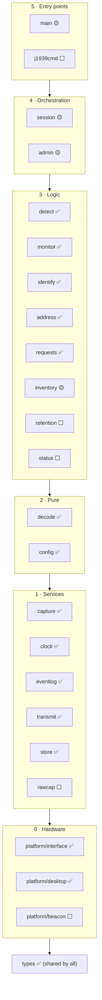

# Module map

What each module and script is for, where it lives, which build step brings it, and how far it has got. Contracts are in `docs/modules.md`, which wins on any boundary question; this page is the plain-language overview. **Update it in every pull request that adds or changes a module or script.**

Last updated: 2026-11-14, step 6 PR 1 (`inventory`).

**Status:** ✅ built · 🟡 minimal or partial (finished in a later step) · ⬜ planned

## Layers

Modules may call only modules in the same layer or below (import-linter checks this in CI). Nothing imports `main`.

## Logger modules (`src/j1939logger/`)

| Module | Layer | Purpose | Step | Status |
| --- | --- | --- | --- | --- |
| `types.py` | shared | The shared data types every module passes around (frames, J1939 messages, NAMEs, clock readings, records, connections, transmit requests, the platform error) and the allowed-value lists from the requirements. | 1 | ✅ |
| `platform/interface.py` | 0 | The hardware boundary: the nine functions any hardware must provide (open the CAN socket, check the bit rate, set the light, read the time, RTC state, wake times, watchdog kick, storage paths, fault hook). | 1 | ✅ |
| `platform/desktop.py` | 0 | The `vcan0` implementation used by every test, with `FakeClock` (tests move time) and a fault plan that injects 12 kinds of error at set times. | 1 | ✅ |
| `platform/beacon.py` | 0 | The DG Beacon implementation of the same interface. | 8 | ⬜ |
| `capture.py` | 1 | The only CAN receiver: a thread that reads frames with kernel timestamps into a queue and a 12 s ring, and counts frames and kernel drops. Gives `transmit` alone a send handle on its socket, so the logger's own frames come back marked (v2). | 1, 3 | ✅ |
| `clock.py` | 1 | The only source of time: real-time clock, else vehicle time as an offset, else time since wake; turns frame times into record times, vehicle times and seconds since wake (v2); logs the first vehicle time and clock skew. | 1–2 | ✅ |
| `eventlog.py` | 1 | The only writer of session files: appends records with the SHA-256 hash chain, one write per record; syncs every 2 s on its own thread and at once after a new device; continues the chain into new parts; writes seconds since wake when there is no valid time; reads the last complete record after a crash. | 1–2 | ✅ |
| `transmit.py` | 1 | The only path to the bus. Refuses and turns transmit off for the session on any breach (PGN outside the allow-list, a request for a PGN not allowed, a claim with another NAME, anything but NACK, CTS, EOMA or Abort); at most 10 frames in any 1 s; one outstanding request per destination; protocol frames first; nothing but claims for 250 ms after a claim; off on bus-off, error-passive or a send error. | 3 | ✅ |
| `store.py` | 1 | The only writer of supporting files (status, inventory, config, library, `state.json` on internal flash): loading the newest or a given version, atomic writes, card space, freeing raw captures only. | 2 | ✅ |
| `rawcap.py` | 1 | Saves raw candump files from 10 s before to 60 s after each new connection or control flag, from capture's ring. | 6 | ⬜ |
| `decode.py` | 2 | Raw frames to J1939 messages: ID split, NAME decode, multi-frame reassembly up to 1785 bytes with timeouts and limits; counts bad input and never crashes on it. Asks for CTS and EOMA for transfers to the logger, and reads bus-off and error-passive from error frames (v2). Marks replies to the logger, including Acknowledgments that name it (DC-16). | 1, 3 | ✅ |
| `config.py` | 2 | Validates the config (every key, type, allow-lists never widened, move grace at most 5 s, detection-weakening changes flagged) and the inventory and library files; refuses unknown formats. | 2 | ✅ |
| `detect.py` | 3 | Decides when a device connects, moves or ends: connections keyed by NAME, or by address for a device that never claims; the first-sweep wait; traffic from, and replies to, unclaimed addresses; moves (`address_change`) and conflicts (`address_conflict`); silence and key-off ends with `connection_end` filled from `monitor`; the session's address-to-NAME map. Classification by wake timing until `identify` (step 5). | 1, 4 | ✅ |
| `monitor.py` | 3 | What each connected device sends and requests: the PGN table (first, last, count, bounded), the first requests and a count of the rest, ECUs contacted, DM activity, ETP transfers with the memory-transfer flag, proprietary PGNs; `control_flag` and `known_device_new_pgn` records; `summary(conn)` gives `detect` the `connection_end` fields. Raw capture trigger in step 6. | 4, 6 | 🟡 |
| `identify.py` | 3 | What kind of device it is: the category at connection start (trailer by NAME, else wake timing) and reclassification; the library score (function gate, Jaccard minus never-PGN penalties, tie margin, SA hints for exact ties); make and model from self-reported replies, the manufacturer list, then the library; confidence from agreeing sources; the `identification` record. | 5 | ✅ |
| `address.py` | 3 | The logger's own address claim: from 247 down, skipping known, claimed and reserved addresses; always concedes; one more try, then Cannot Claim; answers Request for Address Claim, NACKs other requests to the logger, ignores Commanded Address. | 3 | ✅ |
| `requests.py` | 3 | The logger's requests: the address-claim sweep at start and every 10 min (sweep records for the first and for changes), Time/Date and VIN to the VIN address, identity requests to devices without a known NAME; 1.25 s timeout and one retry; outcomes for `identify`; failed requests not repeated. | 3 | ✅ |
| `inventory.py` | 3 | The known-good devices for this truck: training (every NAME and unclaimed address, the conditions from engine speed, vehicle speed and PTO, identity replies, timeout), the proposed inventory, next versions and entry IDs that are never reused, approvals from logged events (device, PGN sent or requested, address) and removals, with their records. Wired into the session in step 6 PR 3. | 6 | 🟡 |
| `retention.py` | 3 | Keeps the card from filling: decides which raw captures may be freed; never session files. | 6 | ⬜ |
| `status.py` | 3 | The status file and the one status light (fast blink beats slow blink beats steady). | 7 | ⬜ |
| `session.py` | 4 | The session lifecycle and main loop: header and end records, session numbering and `state.json`, how the last session ended, key-off after 30 s and a new session on the next frame, 24 h roll-over into parts, watchdog kicks; listen-only until the bit rate is confirmed, then normal mode, the address claim and the request schedule; transmit off on bus-off or error-passive; the restart guard; the VIN check; drives `detect` and `monitor` (the first-sweep signals, timed checks, `connection_end` before `session_end`); loads the device library and runs `identify` (identification, final identification, reclassification). Status file and commands come in step 7. | 1–3, 7 | 🟡 |
| `admin.py` | 4 | The diagnostic log (built: one line per event, repeats counted, rotated, restart causes for the next session) and, in step 7, restart and retrain. | 2, 7 | 🟡 |
| `main.py` | 5 | Service entry point. Now: reads and validates the config and inventory files and runs a session on the desktop platform. Later: the command socket (`cmdserver`). | 1, 7 | 🟡 |
| `j1939cmd.py` | 5 | The logger-side program each laptop command runs over SSH; passes the request to the service over a Unix socket. | 7 | ⬜ |

## Tools and scripts

| Script | Purpose | Step | Status |
| --- | --- | --- | --- |
| `tools/check_verification.py` | CI coverage check (DC-2): every T requirement of a merged step names an existing test; release mode also needs results and no `errors.md` placeholders. | 1 | ✅ |
| `.github/workflows/ci.yml` | CI on every push: `vcan0`, can-utils, ruff, mypy, import-linter, pytest with coverage, the no-hardware demo, the coverage check. | 1–2 | ✅ |
| `tools/verify_chain.py` | Standalone chain verifier: checks session files across parts and sessions, names changed and missing records, reports truncated lines, new cards and open sessions without failing, refuses unknown formats. | 2 | ✅ |
| `demo/run_demo.sh` | No-hardware demo on `vcan0`: runs the logger, replays the session 142 capture, verifies the chain and checks the scan tool's `connection_start`; also the CI smoke test. The laptop tool joins in step 7. | 2 | ✅ |
| `tools/j1939ctl/` | The operator's laptop tool on Windows: the 16 commands, retrieval, the report. | 7 | ⬜ |
| `tools/anonymize_capture.py` | Scrubs VINs and serial numbers from rig captures before they go in `tests/fixtures/rig/`. | — | ⬜ |
| `release/install.sh`, `keys.sh`, service unit | Offline install, operator keys, the systemd service. | 8–9 | ⬜ |

Test-side scripts (harness, `ecu_sim`, witness, `tools/fixtures/scenario.py`, `tools/findings/`) belong to the test-script writers (DC-4) and are not listed here.
