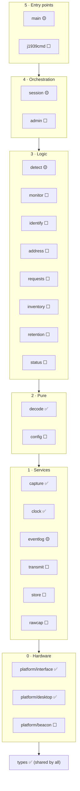

# Module map

What each module and script is for, where it lives, which build step brings it, and how far it has got. Contracts are in `docs/modules.md`, which wins on any boundary question; this page is the plain-language overview. **Update it in every pull request that adds or changes a module or script.**

Last updated: 2026-11-13, after build step 1 (PRs #2 to #4).

**Status:** ✅ built · 🟡 minimal or partial (finished in a later step) · ⬜ planned

## Layers

Modules may call only modules in the same layer or below (import-linter checks this in CI). Nothing imports `main`.

## Logger modules (`src/j1939logger/`)

| Module | Layer | Purpose | Step | Status |
| --- | --- | --- | --- | --- |
| `types.py` | shared | The shared data types every module passes around (frames, J1939 messages, NAMEs, clock readings, records, connections, transmit requests, the platform error) and the allowed-value lists from the requirements. | 1 | ✅ |
| `platform/interface.py` | 0 | The hardware boundary: the nine functions any hardware must provide (open the CAN socket, check the bit rate, set the light, read the time, RTC state, wake times, watchdog kick, storage paths, fault hook). | 1 | ✅ |
| `platform/desktop.py` | 0 | The `vcan0` implementation used by every test, with `FakeClock` (tests move time) and a fault plan that injects 12 kinds of error at set times. | 1 | ✅ |
| `platform/beacon.py` | 0 | The DG Beacon implementation of the same interface. | 8 | ⬜ |
| `capture.py` | 1 | The only CAN receiver: a thread that reads frames with kernel timestamps into a queue and a 12 s ring, and counts frames and kernel drops. | 1 | ✅ |
| `clock.py` | 1 | The only source of time: real-time clock, else vehicle time as an offset, else time since wake; turns frame times into record times; logs the first vehicle time and clock skew. | 1 | ✅ |
| `eventlog.py` | 1 | The only writer of session files: appends records with the SHA-256 hash chain, one write per record, and syncs. Parts, roll-over and crash recovery come in step 2. | 1–2 | 🟡 |
| `transmit.py` | 1 | The only path to the bus: allow-list, 10 frames/s cap, one request per destination; turns transmit off on any breach. | 3 | ⬜ |
| `store.py` | 1 | The only writer of supporting files (status, inventory, config, library, `state.json`): loading and atomic writes. | 2 | ⬜ |
| `rawcap.py` | 1 | Saves raw candump files from 10 s before to 60 s after each new connection or control flag, from capture's ring. | 6 | ⬜ |
| `decode.py` | 2 | Raw frames to J1939 messages: ID split, NAME decode, multi-frame reassembly up to 1785 bytes with timeouts and limits; counts bad input and never crashes on it. | 1 | ✅ |
| `config.py` | 2 | Validates and versions the config (and the inventory and library files); rejects unknown keys and allow-list additions. | 2 | ⬜ |
| `detect.py` | 3 | Decides when a device connects, moves or ends. Now: a new NAME opens a connection with a wake-timing category. Full rules come in step 4. | 1, 4 | 🟡 |
| `monitor.py` | 3 | What each connected device sends and requests: PGN tables, requests kept, DM activity, control-PGN flags. | 4 | ⬜ |
| `identify.py` | 3 | What kind of device it is: category, type, make, model and confidence from NAME, identity replies and the device library. | 5 | ⬜ |
| `address.py` | 3 | The logger's own address claim (128 to 247, always concedes). | 3 | ⬜ |
| `requests.py` | 3 | The logger's requests: sweeps, Time/Date, VIN and identity, with timeouts and one retry. | 3 | ⬜ |
| `inventory.py` | 3 | The known-good devices: training, approvals, removals, versions. | 6 | ⬜ |
| `retention.py` | 3 | Keeps the card from filling: decides which raw captures may be freed; never session files. | 6 | ⬜ |
| `status.py` | 3 | The status file and the one status light (fast blink beats slow blink beats steady). | 7 | ⬜ |
| `session.py` | 4 | The session lifecycle and main loop. Now: runs capture, decode, clock, detect and eventlog and syncs after a new device. Header, end record, parts, `state.json`, self-check, watchdog and restart guard come in step 2. | 1–2 | 🟡 |
| `admin.py` | 4 | Restart, retrain and the diagnostic log. | 2, 7 | ⬜ |
| `main.py` | 5 | Service entry point. Now: reads the config and inventory files and runs a session on the desktop platform. Later: the command socket (`cmdserver`). | 1, 7 | 🟡 |
| `j1939cmd.py` | 5 | The logger-side program each laptop command runs over SSH; passes the request to the service over a Unix socket. | 7 | ⬜ |

## Tools and scripts

| Script | Purpose | Step | Status |
| --- | --- | --- | --- |
| `tools/check_verification.py` | CI coverage check (DC-2): every T requirement of a merged step names an existing test; release mode also needs results and no `errors.md` placeholders. | 1 | ✅ |
| `.github/workflows/ci.yml` | CI on every push: `vcan0`, ruff, mypy, import-linter, pytest with coverage, the coverage check. | 1 | ✅ |
| `tools/verify_chain.py` | Standalone chain verifier: checks a folder of session files and names the first broken or missing record. | 2 | ⬜ |
| `demo/run_demo.sh` | No-hardware demo on `vcan0` (session 142 scenario); also the CI smoke test. | 2 | ⬜ |
| `tools/j1939ctl/` | The operator's laptop tool on Windows: the 16 commands, retrieval, the report. | 7 | ⬜ |
| `tools/anonymize_capture.py` | Scrubs VINs and serial numbers from rig captures before they go in `tests/fixtures/rig/`. | — | ⬜ |
| `release/install.sh`, `keys.sh`, service unit | Offline install, operator keys, the systemd service. | 8–9 | ⬜ |

Test-side scripts (harness, `ecu_sim`, witness, `tools/fixtures/scenario.py`, `tools/findings/`) belong to the test-script writers (DC-4) and are not listed here.
