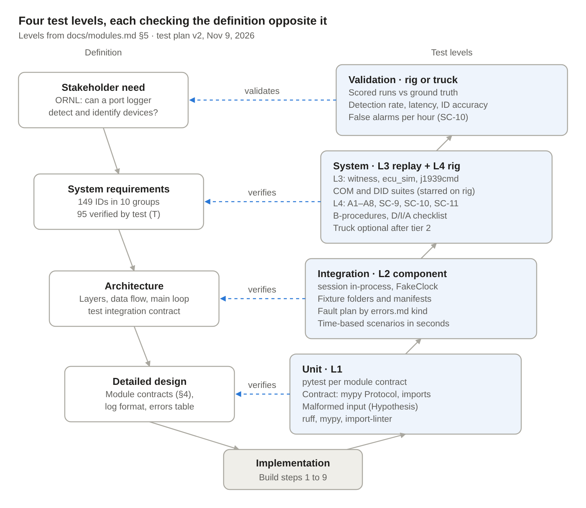
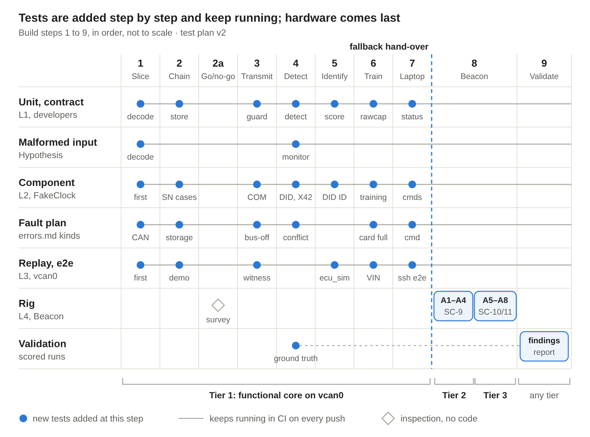

# J1939 Event Logger: V-Model Test Plan

Version 2, Nov 9, 2026 · Vaughan Lynn

This plan verifies the J1939 connected-devices event logger against its 149 requirements and validates it against ORNL's question: can a logger at the 9-pin port detect and identify connected devices from their messages? It uses the four test levels in `docs/modules.md` §5 (unit, component, replay, acceptance) plus validation, run mostly in Python on desktop Linux and then on the Beacon bench rig.

- **Where it lives:** this file is the plan. The Claude Doc of the same name is frozen as of Nov 9, 2026; the plan changes only through pull requests, like the other specs (X19).
- **Authority:** the requirements win, then `docs/log-format.md`, then `docs/modules.md` on module boundaries and on how tests plug in, then the hand-off. If this plan disagrees with any of them, the plan is wrong; report it.
- **Companion files:** `docs/test-matrix.md` (which levels each module gets; spreadsheet copy in `docs/test-plan/`), `bench/checklists.md` (every D, I and A requirement), the diagrams in `docs/test-plan/`, and `docs/test-plan/walkthrough.md` (the same plan in build order, in plain language).
- **What changed from version 1** is listed in section 12.

## 1. Scope and V-model mapping

Every test traces to a requirement ID. Every requirement marked T (95 not deferred, after DC-3) gets an automated test, a `bench/` procedure, or both. The 14 Deferred requirements keep their "Deferred, not built" rows. The 50 requirements whose method includes D, I or A each have an item in `bench/checklists.md`.

| Left side (definition) | Right side (test level) | Runs on | Evidence |
| --- | --- | --- | --- |
| Stakeholder need: ORNL's detect-and-identify question | **Validation:** scenario runs scored against ground truth written before each run | Bench rig; truck if time allows | `docs/findings.md`, `docs/findings-data/` |
| System requirements (SC, NP, TRN, DET, IDN, LOG, STS, LAP, HW, PLT) | **System verification:** level 3 replay and end to end on `vcan0`; level 4 acceptance (A1 to A8, SC-9, SC-10, SC-11, bench procedures, checklists) | `vcan0` in CI; Beacon 1 with Beacon 2 as witness | CI run; `docs/verification.md`; `docs/test-report.md` |
| Architecture: layering, data flow and the main loop (`docs/modules.md` §2, §3), log format | **Integration:** level 2 component tests, `session` in-process with `DesktopPlatform(fault_plan)` and `FakeClock` | Desktop, CI | CI run |
| Detailed design: module contracts (`docs/modules.md` §4), `docs/errors.md` | **Unit:** level 1 unit, contract and malformed-input tests | Desktop, CI | CI run, coverage report |

Out of scope: listen-only devices, timing and cadence detection, below-message methods, J1708/J1587, ISO 15765, and full fuzzing (SC-12, deferred).

## 2. Test levels and tooling

The levels are the ones in `docs/modules.md` §5. Each uses only its listed entry point, so tests don't depend on how a module is built inside.

| Level | Entry point | Use it for | Time | Runs |
| --- | --- | --- | --- | --- |
| 1. Unit | A module's public functions (`docs/modules.md` §4) | Logic and known answers; contract tests; malformed input | `FakeClock` | CI, every push |
| 2. Component | `session` in-process with `DesktopPlatform(fault_plan)` and `FakeClock`; frames fed from a fixture folder | Every time-based scenario (60 s silence, 10-minute sweeps, 24 h roll-over, 120-minute training timeout), every fault-injection test, and every open-loop detection scenario | `FakeClock`, advanced by the test | CI, every push |
| 3. Replay (end to end) | The service on `vcan0`; commands through `j1939cmd` | What needs a real bus or process: the witness, closed-loop `ecu_sim` responders, the command path over SSH, `demo/run_demo.sh` | Real time | CI, every push |
| 4. Acceptance | `bench/` procedures A1 to A8 and the SC-9, SC-10 and SC-11 runs | Hardware results | Real time | On the rig, per tier |

**Folders:** level 1 in `tests/unit/`, `tests/contract/` and `tests/malformed/`; level 2 in `tests/component/`; level 3 in `tests/replay/`, with helpers in `tests/harness/` and fixture folders in `tests/fixtures/`; level 4 in `bench/` (see the repository layout in `docs/handoff.md`).

**Why time-based tests are component tests:** `canplayer` plays in real time, so a 24 h roll-over over replay takes 24 h. At level 2 the fixture's frames are fed in-process and `FakeClock` is advanced, so the same scenario runs in seconds. Replay is kept for what genuinely needs a bus.

**Tooling (pinned by version and hash in `pyproject.toml`):**

- **Python 3.9** in CI and on the desktop (DC-1), until build step 2a confirms the Beacon's version.
- **pytest** for levels 1 to 3, with markers `unit`, `contract`, `malformed`, `component`, `replay` and `slow`.
- **Hypothesis** for property-based and malformed-input tests (SC-12a).
- **python-can** as a dev-only extra for the replay harness (witness and `ecu_sim`). The logger reads CAN through raw sockets; a CI check fails if `src/` imports `can` outside `platform/` (X22).
- **mypy** checks every implementation against its `Protocol` (for example `platform/interface.py`).
- **import-linter** enforces the layers in `docs/modules.md` §2.
- **ruff**, **pytest-cov** (report, no threshold), **can-utils** (`canplayer`, `candump`, `cangen`).

**CI checks besides the tests:** `demo/run_demo.sh` as a smoke test; `tools/check_verification.py` (staged by build step, DC-2); the release check that no `docs/errors.md` Test cell holds a placeholder.

## 3. Fixtures, injection points and ownership

**Fixture folder** (`tests/fixtures/<scenario>/`), as in `docs/modules.md` §5:

- `traffic.log`: candump `-L` format, the bus as the logger would see it.
- `manifest.json`: config, overrides, inventory, library, `clock_start_utc`, `faults` (kinds from the Kind column of `docs/errors.md`) and `expect` entries matched on `type`, `sev` and listed fields only, with `within_s`, `count: 0` and `expect_no_other`.

**Ground truth for validation.** `tools/fixtures/scenario.py` turns one scenario description (baseline traffic plus devices joining and leaving at set times) into three outputs: `traffic.log` and `manifest.json` in the fixture folder, read by pytest at levels 2 and 3, and `docs/findings-data/scenarios/<scenario>.json` in the findings-spec format, read by `tools/findings/`. One description, two formats, no new spec format.

**Injection points** (the only ways a test reaches inside):

- Time: `FakeClock` (`advance`, `jump`).
- Faults: `DesktopPlatform(fault_plan=[(at_mono, kind, args)])`, using `docs/errors.md` kind spellings (for example `card_removed`, `bus_off`, `state_corrupt`, `name_collision`).
- Commands: the `cmdserver` socket at level 2; `j1939cmd` at level 3.

There is no separate fakes module: `FakeClock` and `DesktopPlatform` are the interface code merged first in build step 1.

**Replay harness** (`tests/harness/`):

| Helper | What it does |
| --- | --- |
| `witness.py` | A second socket on `vcan0` that records everything the logger sends and checks: allow-listed PGNs only, at most 10 frames/s in any 1 s window, one outstanding request per destination, nothing before bit-rate confirmation. Stands in for Beacon 2. |
| `ecu_sim.py` | Closed-loop simulated ECUs that answer the logger's requests (VIN, Time/Date, Component, Software and ECU ID), NACK, stay silent, or contest an address claim. |
| `logger_proc.py` | Starts the service with a temporary card and flash directory and a fixture's config and inventory; waits for a record; stops it cleanly or kills it. |
| `records.py` | Loads a session file, applies the manifest matching rules, and runs `verify_chain` over every session file a test writes. |
| `frames.py` | Builds J1939 frames for scenarios and Hypothesis strategies, from the shared types in `types.py`. |

**Who owns what** (`docs/modules.md` §5, as extended by DC-4):

| Area | Owner | Changes to the other side's area |
| --- | --- | --- |
| `src/`, unit tests (`tests/unit/`), contract tests (`tests/contract/`) | Developers (Claude Code sessions) | Only through a DC entry |
| `tests/fixtures/`, manifests, `tools/fixtures/`, `tests/harness/`, `tests/component/` (including its fixture runner), `tests/replay/`, `bench/` procedures and checklists, `tools/findings/` | Test-script writers (the test-script chat) | Only through a DC entry |

Section 4's unit cases are the checklist developers must cover; test-script writers check them in review but don't write them.

**Naming:** every test name starts with the requirement ID it verifies (`test_DET_4_copied_name_raises_conflict`); a fixture's `requirements` list ties it to the verification matrix.

## 4. Unit, contract and malformed-input tests (level 1)

Written against the contract frozen for the build step (`docs/modules.md` §6). When a DC entry raises a contract version, the affected tests and fixtures change in the same pull request.

| Module | Step | Cases to cover | Requirements |
| --- | --- | --- | --- |
| `decode` | 1 | ID split; PDU1 vs PDU2; NAME decode (the logger's NAME `0x9FFEFFFFFFE00001`); BAM and RTS/CTS reassembly; 1785 bytes accepted, 1786 rejected; T1 to T4 timeouts; ETP recognized, not reassembled; 11-bit, remote and error frames counted, never decoded | IDN-1, NP-15, DET-10, DET-19 |
| `capture` | 1 | Ring filled directly; `window()` returns the right frames; ring length `raw_before_s` + 2 s; **`Frame.ts_mono` is the kernel time converted to monotonic: a batch read 1.5 s late doesn't shift it**; stats (kernel drops, buffer size, frames by type) | SC-2, LOG-15 |
| `clock` | 1 | Source choice (RTC, vehicle offset, elapsed); `to_utc(ts_mono)`; skew fault above 5 minutes; `jump` doesn't move timers; with `rtc_ok()` false the logger starts at once and records `clock_source` "elapsed" (it never waits for the clock) | LOG-16 |
| `eventlog` | 1–2 | Hash serialization (compact JSON, key order, numbers as written); recompute every hash in the session 142 file; one changed byte named by the verifier; chain across parts; last hash rebuilt from the last complete line; one `write()` per record | LOG-3, LOG-4, LOG-5, LOG-14 |
| `store` | 2 | Round-trip of status, inventory, config, library, manufacturer list and `state.json` in a temporary directory; `write_atomic` (temporary file, sync, rename, directory sync); leftover temporary files ignored; missing file loads as None; write errors from the fault plan become a `fault` record; `state.json` written to flash, everything else to the card; frees only what `retention` lists | LOG-5, LOG-13, LOG-23, TRN-6, STS-3 |
| `config` | 2 | Unknown or missing keys rejected; allow-list additions rejected; move grace over 5 s rejected; weakening changes need `--confirm`; `validate_inventory` and `validate_library` accept the session 142 examples and reject corrupt ones | STS-9, LOG-13, STS-19 |
| `verify_chain` | 2 | Session 142 passes; first broken or missing record named; truncated last line reported as truncated; unknown format version refused; a replacement card's first record (64 zeros, `new_card: true`) reported as a declared break, not tampering | LOG-5, LOG-14, LOG-19 |
| `transmit` | 3 | Allow-list breach never sent and turns transmit off; 30 queued requests never exceed 10 frames/s; one outstanding request per DA; protocol responses jump the queue; nothing before bit-rate confirmation | NP-9, NP-16, NP-18 |
| `address` | 3 | Address from 247 down, skipping baseline, earlier-claimed and reserved (128, 142) addresses; lower NAME wins; one retry, then Cannot Claim; Commanded Address to its own NAME ignored | NP-4, NP-5, NP-7, NP-8 |
| `requests` | 3 | 1.25 s timeout and one retry; reply, NACK and no response recorded; no repeat in a session; a known NAME at a new address not asked; first-sweep signal | NP-11 to NP-14 |
| `detect` | 4 | One connection when a device sends then claims; address-to-NAME map; move confirmed after the grace or same-NAME conflict; first-sweep wait; silence end vs key-off | DET-1 to DET-6, DET-15 |
| `monitor` | 4 | PGN table (first, last, count); 150 requests give 100 kept and 50 counted; control-PGN list; DM activity; proprietary PGNs; new PGN by NAME | DET-7 to DET-12 |
| `identify` | 5 | Category rules (DET-13, DET-18); IDN-4 score known answers: {A, B, C} against typical {A, B, D} is Jaccard 0.5, minus 0.25 for a never-PGN, so 0.25; floor 0; tie margin 0.1; make and model precedence and `make_source`; **session 142 at identification time: code reader 0.60, service tool 0.40**; recalculation at connection end | DET-13, DET-18, IDN-3, IDN-4, IDN-6 |
| `inventory` | 6 | Versions and permanent entry IDs (E07 retired, never reused); nothing added automatically; approvals of kind device, PGN and address; removals. File round-trips are `store` tests | TRN-10, TRN-11, TRN-14, TRN-15 |
| `rawcap` | 6 | Every window covers −10 s to +60 s around its trigger and contains its record's `utc`; file names by session, connection and event | LOG-10 |
| `retention` | 6 | Removal order; never session files; reserve kept; nearly full is notice, full is high | LOG-11, LOG-22 |
| `status` | 7 | Light priority table (fast > slow > steady; off while starting); VIN mismatch, transmit off and restart loop give fast blink; status file fields | STS-1 to STS-3 |
| `cmdserver` | 7 | Protocol version checked; unknown command and bad arguments refused with a reason; one command at a time; never changes state itself | STS-23 |
| `platform` (desktop) | 1 | Every kind in `docs/errors.md` can be raised from the fault plan; `FakeClock` drives `now()` | PLT-2 (desktop half), STS-18 |

`session`, `admin`, `j1939cmd` and `j1939ctl` are tested at levels 2 and 3 (their contracts name those seams).

**Contract tests (`tests/contract/`):** mypy checks each implementation against its `Protocol`; one test per module imports only the public names in `docs/modules.md` §4; the import-linter rule checks the layers. Added with each module's freeze.

**Malformed input (`tests/malformed/`, SC-12a):** Hypothesis starts with `decode` in **step 1** (bad lengths, out-of-order and duplicate TP.DT, RTS over 1785 bytes, aborts, ETP fragments, bad and all-zero NAMEs) and adds `monitor` in step 4 (floods of new addresses and PGNs). Properties: no unhandled exception, decoding continues, open transfers never exceed `limits.tp_sessions`, PGNs per connection never exceed `limits.pgns_per_conn`, malformed counts match what was sent. Fixed seed in CI, random seed nightly; failures saved as regression cases.

## 5. Communications tests

Communications tests prove the logger joins the bus safely. Level shows where each runs; starred tests repeat on the rig with Beacon 2 as witness.

| ID | Test | Level | Setup | Pass criterion | Requirements |
| --- | --- | --- | --- | --- | --- |
| COM-01\* | Bit-rate detection | Component; rig A1 | Desktop platform reports the rate; rig traffic at 250 and 500 kbit/s | Rate confirmed from clean frames in listen-only; header records rate and method | SC-2, NP-1 |
| COM-02\* | Listen-only, then normal mode | Replay; rig A2 | Witness from power-on | No logger frame before confirmation; claim follows the switch | NP-1, NP-2 |
| COM-03 | No bit rate | Component | Silent bus; error frames only; fault `no_bitrate` | Never transmits; fault and fast blink after 60 s; keeps trying | NP-17 |
| COM-04 | Address claim | Component; replay | Baseline 247 and 246; reserved 128 and 142 | Claims 245 with the NP-5 NAME; nothing else for 250 ms | NP-4, NP-5, NP-6 |
| COM-05\* | Address conflict | Replay; rig A3 | `ecu_sim` (`bench/tools/` on the rig) contests twice with a lower NAME | Moves once, then Cannot Claim and receive-only; both logged | NP-7, DET-4 |
| COM-06 | Protocol responses | Component | Request for Address Claim (to the logger and global); another request to the logger | Re-claims; NACKs | NP-8 |
| COM-07 | Sweep schedule | Component | `FakeClock` advanced 35 minutes | Global Request for Address Claim after claiming and every 10 minutes | NP-11, LOG-9 |
| COM-08 | Session-start requests | Replay | `ecu_sim` engine at SA 0 answers | VIN to `requests.vin_sa` and Time/Date at start; replies recorded | NP-12 |
| COM-09 | Identity requests | Replay | New device answers Component ID, NACKs Software ID, ignores ECU ID | 1.25 s timeout, one retry; three outcomes recorded; none repeated | NP-13, NP-14 |
| COM-10\* | Transmit guard | Unit; component; rig A3 | Fault `tx_breach`; a burst above 10 frames/s | Offending frame never sent; transmit off; high fault | NP-9, NP-16, NP-18 |
| COM-11\* | Bus-off and error-passive | Component; rig A3 | Faults `bus_off`, `error_passive`; on the rig, no ACK partner | Transmit off for the session; listen-only; fault; detection continues | NP-3 |
| COM-12 | Own traffic excluded | Replay | Logger claims and requests while a device replies | No records from its own frames or replies to it | NP-15 |
| COM-13 | Transport protocol | Unit; replay | BAM and RTS/CTS, to the logger and others; abort, timeout, oversize | Reassembled; CTS and EOMA only for transfers to the logger; Abort for a rejected one | NP-9, DET-19 |
| COM-14 | Restart loop | Component; replay | Guard state of 3 unclean restarts in 10 minutes; replay kills the service 3 times | Next session listen-only, transmit off, high fault, fast blink until `restart` | NP-19 |
| COM-15\* | Non-disruption | Rig (A3) | 30 minutes with and without the logger | Witness bus-error counts don't rise | SC-4 |
| COM-16\* | Throughput | Rig (A4) | `cangen` 60% load at 500 kbit/s for 30 minutes with 2 s bursts at 100%; 10 minutes at 100% | Zero drops at 60%; CPU, memory and drops recorded for both | SC-9, LOG-15, PLT-7 |
| COM-17 | Commanded Address to the logger | Component; replay | Commanded Address (65240) naming the logger's NAME | Ignored: no address change, no claim at the commanded address, no transmit | NP-8 |

Every replay test also checks the transmit statement: the PGNs the logger sent in the whole run are a subset of `transmit.allow_list`.

## 6. Detection and identification tests

Detection passes when every scripted connection gets its `connection_start` within 2 s with the right category and severity, and baseline traffic produces no high events. Identification accuracy is measured and reported, not a pass criterion (SC-11). Open-loop scenarios run at level 2 from fixture folders; scenarios that need identity or VIN replies run at level 3 with `ecu_sim`. All of them are replayed on the rig as the SC-11 suite.

**Detection:**

| ID | Scenario | Level | Expected result | Requirements |
| --- | --- | --- | --- | --- |
| DID-01 | Scan tool claims SA 249, sends DM1 and DM2 requests | Component | External device, high; DM activity | DET-1, DET-10, DET-16 |
| DID-02 | Device sends at SA 250 unclaimed, later claims | Component | One connection keyed by SA, NAME linked | DET-2, DET-15 |
| DID-03 | Approved ELD connects and disconnects | Component | Info start and end with NAME, address, duration | DET-17 |
| DID-04 | A known ECU replies to an address no claimed NAME holds this session | Component | Detected (DID-31 covers the excluded addresses) | DET-3 |
| DID-05 | NAME appears, then disappears, between sweeps | Component | Sweep change logged | DET-5, LOG-9 |
| DID-06 | One device silent 60 s with the bus active; another until key-off | Component | Silence end at its last frame; key-off end | DET-6, LOG-17 |
| DID-07 | Unrecognized device: 12 PGNs, 150 requests | Component | PGN table; 100 requests kept, 50 counted | DET-7, DET-8 |
| DID-08 | TSC1, later XBR and DM11 | Component | Each flagged at first occurrence with a running count; raw capture saved | DET-9, LOG-10 |
| DID-09 | DM14 with an ETP transfer | Component | ETP logged, flagged as a memory transfer | DET-10 |
| DID-10 | Proprietary A and B PGNs | Component | Logged without interpretation | DET-11 |
| DID-11 | Known NAME sends a PGN not seen in training | Component | Notice `known_device_new_pgn` | DET-12 |
| DID-12 | ECU claims at 5 s, sends all session, no requests | Component | Vehicle ECU not in baseline, high, rule named | DET-13 |
| DID-13 | Device claims at 12 s and sends a Request | Component | External device, high | DET-13 |
| DID-14 | VIN differs from the inventory; second run with no VIN reply | Replay | `vin_mismatch` high, untrained session; then VIN unavailable, normal session | DET-14 |
| DID-15 | Trailer NAME broadcasting; second run sends a diagnostic request | Component | Trailer, notice; then external, high, with reason | DET-18 |
| DID-16 | 40 new NAMEs in a minute; oversize transfer | Component | Within DET-19 limits; counts recorded | DET-19 |
| DID-17 | Untrained truck | Component | All unrecognized, capped at notice, needs-training state | TRN-9 |
| DID-36 | One device of each category (external, vehicle ECU not in baseline, trailer, approved external) plus baseline ECUs | Component | Each connection record holds the LOG-7 fields for its category (approved external: the short form); baseline ECUs produce no connection record | LOG-7 |

**Name tracking (X42):** DID-25 to DID-33, all at level 2 (the move grace and first-sweep wait are time-based).

| ID | Scenario | Expected result | Requirements |
| --- | --- | --- | --- |
| DID-25 | Known ECU claims a free address; old address silent | Info `address_change` after `detection.move_grace_s`; no false DET-2, DET-3 or new-PGN events; no identity requests | DET-4, DET-12, NP-13 |
| DID-26 | Known ECU moves onto another known ECU's usual address | `address_change` at notice | DET-4 |
| DID-27 | Copied NAME while the real ECU keeps sending; second run where both answer a sweep | `address_conflict` "same NAME at two addresses", high, slow blink | DET-4 |
| DID-28 | Frame from the old address after a confirmed move | Same-NAME conflict raised | DET-4 |
| DID-29 | Baseline ECUs claim before the logger is ready; never-claiming inventory device at its stored address | No DET-2 or DET-3 events; decisions wait for the first sweep (sweep plus 1.25 s) | DET-2, DET-3 |
| DID-30 | No sweep possible, with a new never-claiming device present at start | Wait ends `detection.first_sweep_wait_s` (10 s) after ready; `connection_start` within 2 s of the wait's end | DET-2, DET-16 |
| DID-31 | Replies to 255, 254 and the logger's own address; then to an unheld address | First three ignored; last detected | DET-3 |
| DID-32 | Approved address move; same address next session; another move within a session | Approval kind address; no repeat; each NAME and new-address pair once per session | TRN-10, DET-4 |
| DID-33 | Copied NAME of a known device absent this session | Recorded as a move (known limitation); new-PGN and control flags as backstop | DET-4, DET-9, DET-12 |

**Identification and library stress tests:** level 3 where identity replies are needed (`ecu_sim`), level 2 otherwise. Identification records must hold category, type, make, model, `make_source`, confidence and source.

| ID | Scenario | Expected result | Requirements |
| --- | --- | --- | --- |
| DID-18 | Request pattern matches no library entry | Category from rules; type unknown or low confidence; never forced onto the nearest entry | IDN-3, IDN-4 |
| DID-19 | Leave-one-out over each library entry | Result per device, reported, not pass/fail | IDN-4, IDN-5 |
| DID-20 | Look-alikes within `identify.tie_margin` | Different makes: type only; different types: shared category, candidates, confidence one step lower | IDN-3, IDN-4 |
| DID-21 | NAME says tool; requests and identity say ELD | Self-reported first, then manufacturer code, then library; `make_source` named; disagreement kept; external, high | IDN-3 |
| DID-22 | Device NACKs or ignores every identity request | Identified from NAME and PGNs; outcomes recorded | IDN-3, NP-14 |
| DID-23 | Empty manufacturer list, then a made-up test list | Empty: make from identity or library only; test list: make decoded, `make_source` manufacturer code | IDN-2 |
| DID-24 | Same replay with library v1 and v2 | Results follow the installed library; header records its version | IDN-5, LOG-6 |
| DID-34 | Matches the illustrative specific-product entry, no identity reply | Profile match, `make_source` library, confidence one step lower | IDN-3, IDN-4 |
| DID-35 | Near-tie between the specific and generic entries | Type only | IDN-4 |
| DID-37 | Identification changes after later requests (type, make or model) | `connection_end` carries `final_identification` with the `identification` fields | IDN-4 |
| DID-38 | Identification unchanged at connection end; and an approved external device | `final_identification` absent; absent from the approved device's short `connection_end` | IDN-4 |

**Attack-inspired cases** (from the project attack taxonomy; level 2, then SC-11). A case the logger can't catch is a recorded limitation, not a failure.

| ID | Scenario | Expected result | Requirements |
| --- | --- | --- | --- |
| ATK-01 | Address Claim Hunter: an all-zero NAME answers every claim | The logger concedes, retries once, sends Cannot Claim and goes receive-only (NP-7); each displaced known ECU gives a high `address_conflict`; the attacker is an external device, high | NP-7, DET-1, DET-4 |
| ATK-02 | New NAME claims an inventory ECU's address | High `address_conflict` (known ECU loses its address); attacker external, high | DET-4, DET-1 |
| ATK-03 | New NAMEs claim every address from 128 to 247 | The logger can't hold an address: Cannot Claim, receive-only; new connections logged within DET-19 limits | NP-7, DET-1, DET-19 |
| ATK-04 | Commanded Address (65240) from a new device to a known ECU | High control flag; raw capture saved | DET-9, LOG-10 |
| ATK-05 | Request flood at one PGN from a new device | External, high; first 100 requests kept, rest counted; logger keeps its own rate cap | DET-8, NP-16 |
| ATK-06 | Trailer NAME used as cover for DM14 | Reclassified external, high, with reason; memory transfer flagged | DET-18, DET-10 |

**Benign look-alikes** (false-alarm checks; level 2, then in SC-10 and SC-11):

| ID | Scenario | Expected result |
| --- | --- | --- |
| BEN-01 | Ignition-on claim burst from baseline ECUs | No connection records; no notice or high events; first sweep logged |
| BEN-02 | Baseline ECU goes silent and re-claims the same address (brownout) | No new connection, no `address_change`, no high event |
| BEN-03 | Normal BAM and RTS/CTS transfers between baseline ECUs | No events; transfers counted |
| BEN-04 | Key-off, then wake | Session ends with key-off; next session continues the chain; no high event |

**Latency (DET-16).** On `vcan0`, the witness shares the host clock, so first-frame time to `written` is measured directly. On the rig, use the logger's own times: `connection_start.utc` (the first frame's `ts_mono` through `clock.to_utc`) against `written`. "Synced" is checked through the `eventlog` sync hook (level 2) or `strace` on the rig: `fsync` within 2 s of the first frame. The light change is checked through `set_light` (level 2) and A8 (rig). Raw-capture windows are measured from `ts_mono` too. Median and maximum go to the test report.

## 7. Other function tests

| Area | Level | Key cases | Pass criterion | Requirements |
| --- | --- | --- | --- | --- |
| Session numbering (`state.json`) | Component | Cases SN-a to SN-f below | As in the table below | LOG-5 |
| Chain and verifier | Unit; component | Two sessions as one chain; delete, edit, reorder; truncated line; unknown format; replacement card | First bad record named; truncated reported as truncated; declared break for a new card | LOG-5, LOG-14, LOG-19 |
| Session lifecycle | Component | 30 s key-off; 24 h roll-over; software restart; kill during write | New part continues the chain; restart recorded with cause; gap shown | LOG-2, LOG-12, LOG-17, LOG-18, LOG-20 |
| Write path | Component; rig | `eventlog` sync hook; `strace` on the rig | One `write()` per record, `O_APPEND`; sync every 2 s and at once for `connection_start`; supporting files atomic (`store`) | LOG-3, LOG-23 |
| Storage | Component | Faults `enospc`, `erofs`, `eio`, `card_removed`, `slow_sync`, `card_nearly_full` | Order kept; event files never removed; faults and light as in `docs/errors.md` | LOG-11, LOG-22 |
| Clock | Unit; component | RTC valid, invalid; vehicle time 6 minutes off; `clock_jump` | Right source on every record; notice skew fault; timers unaffected; no wait for the clock | LOG-16, HW-7 |
| Receive buffer | Component; rig | Start-up | `session_start` holds buffer size read back; `session_end` holds kernel drops | LOG-15 |
| Training and inventory | Component | Coverage of key-on, idle, driving, PTO; 120-minute timeout; reject; approvals; removals | Right inventory versions and records; nothing automatic; removed device seen as new | TRN-3, TRN-9 to TRN-12, TRN-14, TRN-15 |
| Configuration | Component; replay | Valid, weakening (including a longer move grace), unknown key, allow-list addition, move grace over 5 s | Saved and applied next session; weakening needs `--confirm`, logged high; last three rejected | STS-9, STS-17 |
| Start-up self-check | Component | Faults `corrupt_file` (inventory, config), `erofs` | Untrained with a high fault; stop with a fault; fault state | STS-19 |
| Watchdog | Component; rig A8 | Fault `hang` in the main loop, then in capture | Restart; cause in diagnostic log and next header | STS-18 |
| Command path | Component (socket); replay (`j1939cmd`) | Faults `cmd_not_running`, `cmd_busy`, `cmd_invalid_id`, `cmd_wrong_state`, `cmd_bad_proto` | Refused with reason and next step; non-zero exit; one at a time | STS-23, LAP-15 |
| Laptop tool | Replay (`ssh localhost`) | `clear`, `approve`, `retrieve` (resume, in-progress session, name clash), `restart`, `retrain`; faults `link_dropped`, `ssh_timeout` | Reasons stored; folder per VIN read-only after verification; partial files re-copied; open session in progress | LAP-4 to LAP-6, LAP-9, LAP-11, STS-11, STS-12 |
| Retrieve name clash | Replay | Same name and content; same name, different content | Same content skipped; different content kept as both, new one renamed with a suffix, reported, never skipped; chain check over the whole set; kind `name_collision` | LAP-5 |
| Operator keys | Replay | `release/keys.sh` add and remove | Fingerprints in `session_start`, mapped to names in records | LAP-8, STS-5 |
| Power | Rig (A5, B-HW3) | 6, 12, 24, 32 V; cranking dip; power pull mid-write | Runs across the range; clean resume; chain rebuilt | HW-3, HW-6, LOG-5 |

**Session numbering cases (LOG-5).** `state.json` is written at session start and after each part; the next number is one more than the higher of `state.json` and the newest session file on the card.

| Case | State file | Card | Expected |
| --- | --- | --- | --- |
| SN-a | Present | Blank | `new_card: true`; first `prev` 64 zeros; number = state + 1; verifier reports a declared break |
| SN-b | Missing (`state_missing`) | Has sessions | Numbering and chain continue from the card; `new_card: false` |
| SN-c | Present but behind (power cut mid-session) | Has sessions | Next = newest on card + 1 |
| SN-d | Corrupt (`state_corrupt`) | Has sessions | Notice fault; continue from the card |
| SN-d2 | Corrupt | Blank | Notice fault; new logger: session 1, 64 zeros |
| SN-e | Missing | Blank | New logger: session 1, 64 zeros |
| SN-f | Not writable (`state_unwritable`) | Any | Notice fault; logging continues. The `install.sh` next-session prompt for a new card is a bench step (B-SN1) |

**`docs/errors.md` rows:** every row gets a test named by its requirement ID, at level 2 through the fault plan unless the row is laptop- or install-side (replay or bench). The new rows `state_missing`, `state_corrupt`, `state_unwritable` (SN cases) and `name_collision` (retrieve name clash) are covered above.

## 8. Build-step gates, system verification and validation

**Gates (CI on `vcan0`).** A step is done when its tests, all earlier tests, ruff, mypy, contract tests and `demo/run_demo.sh` pass, and the pull request template's checklist is complete.

| Build step | Contracts frozen first | Tests added | Gate |
| --- | --- | --- | --- |
| 1. Thin slice | types, platform, capture, decode, eventlog, clock | Unit (decode, capture incl. `ts_mono`, clock, eventlog); Hypothesis on decode; first component and replay test | New claim gives a chained `connection_start` within 2 s (DET-1, DET-16, LOG-4, LOG-5) |
| 2. Sessions and chain | session, eventlog, store, verify\_chain, config | Unit (store, config, verify\_chain); component (lifecycle, SN cases, storage and clock faults) | Two sessions verify as one chain; deleted record named; demo runs session 142 |
| 2a. Beacon go/no-go | none | Checklist items (section 9) | Results in open items and `docs/verification.md` |
| 3. Transmit | transmit, address, requests | COM-01 to COM-14, COM-17 at levels 1 to 3; witness on every replay test | NP-1 to NP-19 |
| 4. Detection | detect, monitor | DID-01 to DID-11, DID-16, DID-25 to DID-33, DID-36; ATK and BEN cases; Hypothesis on monitor | All pass |
| 5. Identification | identify | DID-12, DID-13, DID-15, DID-18 to DID-24, DID-34, DID-35, DID-37, DID-38 | All pass; X15 rule check recorded |
| 6. Training and inventory | inventory, rawcap, retention | Training, approvals, DID-14, DID-17, rawcap windows, storage | All pass |
| 7. Laptop tool | cmdserver, j1939cmd, j1939ctl, admin, status | Status light table; command path; laptop end to end; name clash | All pass; tier 1 reached (fallback hand-over) |
| 8. Beacon | platform (Beacon) | Acceptance (below) | Every hardware-relevant T requirement has a rig result or a recorded gap |
| 9. Validation and documentation | none | Findings scored from ground truth (`tools/findings/`) | Findings report written from scripted data; step 9 checklist items signed (SC-6, IDN-3, IDN-4, STS-8); test report written |

**Acceptance on the rig (level 4).** Beacon 1 runs the release installed offline by `install.sh`; Beacon 2 replays traffic and records as witness.

| Test | Checks | Pass | Requirements | Tier |
| --- | --- | --- | --- | --- |
| A1 | Bit-rate detection on a single J1939 network at the 9-pin | Correct rate at 250 and 500 kbit/s | SC-1, SC-2, NP-1, PLT-2 | 2 |
| A2 | Listen-only start, then normal mode | Nothing transmitted before confirmation | NP-1, NP-2, PLT-2 | 2 |
| A3 | Transmit guard, conflict, bus-off; 30 minutes with and without the logger | Only allowed frames; concedes; bus errors don't rise | NP-3, NP-9, NP-16, NP-18, SC-4 | 2 |
| A4 | 60% load with bursts; 100% run | Zero drops at 60%; CPU, memory, drops recorded | SC-9, PLT-7 | 2 |
| A5 | Power loss mid-write; cranking brownout | Clean resume; chain rebuilt; gap flagged | HW-6, LOG-5, LOG-12, LOG-14 | 3 |
| A6 | Ready time after power-on | Recorded in the header | HW-8 | 3 |
| A7 | RTC across power loss | Right clock source; no wait for the clock | HW-7, PLT-3, LOG-16 | 3 |
| A8 | Each light state; watchdog restart | Right pattern; restart with cause | STS-1, STS-18, PLT-8 | 3 |
| SC-10 | 24 h replay; scripted connection every hour; key cycle every 6 h | No restarts; memory growth under 10% measured after the first hour; dropped frames within the SC-9 limit; every scripted connection detected; per-session tables at their fixed limits | SC-10 | 3 |
| SC-11 | Section 6 fixtures replayed on the rig, real devices where available; the SC-10 run as its 24 h baseline | Every scripted connection detected and categorized within 2 s; no high events other than the manifest's scripted connections; accuracy reported | SC-11, SC-3 | 3 |

**Bench procedures for other hardware T requirements:**

| Procedure | What | Requirements |
| --- | --- | --- |
| B-HW1 | Measure the tap stub (tap leg plus logger cable) and record it against 0.5 m; note the vehicle stub and any tool cable | HW-1 |
| B-HW3 | Bench supply at 6, 12, 24 and 32 V; logger runs and records at each | HW-3 |
| B-PLT2 | Read `ip -details link show` and the capture stats: listen-only mode, error-frame reporting, kernel timestamps, `SO_RXQ_OVFL` readable, termination off, at both rates | PLT-2 |
| B-STS20 | Run `install.sh` on a fresh Beacon and check each hardening step on the install checklist | STS-20 |
| B-SN1 | With flash read-only, fit a new card; `install.sh` asks for the next session number | LOG-5 |

**SC-11 baseline (decided Nov 9, 2026).** The SC-10 run is SC-11's 24-hour baseline: it passes when there are no high events other than the scripted connections listed in its manifest. No separate 24-hour replay is run.

**Validation.** Score the SC-11 runs (and any truck runs) with `tools/findings/` against the ground-truth files `scenario.py` wrote before each run: detection rate, DET-16 latency (median, maximum), identification accuracy and confusion table, evidence-source contribution, confidence calibration, leave-one-out accuracy (DID-19), unknown devices correctly left unidentified (DID-18), false alarms per hour from the SC-10 baseline, and every miss with its cause. Written at whatever tier is reached.

## 9. Demonstration, inspection and analysis

`bench/checklists.md` lists all 50 requirements whose method includes D, I or A, each with its build step, observer and evidence. Several also get automated end-to-end checks: LAP-15 (refusal messages and exit codes), STS-2 (slow blink until cleared), LAP-12 (offline report), LAP-13 (CSV export) and LAP-17 (plain words).

Step 2a adds two checks to the go/no-go list: the boot clock (after a power cycle with no network, `date` matches `hwclock` before the service starts) and internal flash writable (for `state.json`).

## 10. Traceability and the CI coverage check

The full matrix stays in `docs/verification.md`. Counts exclude Deferred requirements; a requirement with two methods counts under both.

| Group | Not deferred | T | D | I | A | Main suites |
| --- | --- | --- | --- | --- | --- | --- |
| SC | 11 | 8 | 2 | 2 | 1 | A1, A3, A4, SC-10, SC-11, SC-12a |
| NP | 18 | 18 | 0 | 1 | 0 | Unit; COM-01 to COM-17; A1 to A3 |
| TRN | 13 | 7 | 3 | 3 | 0 | Component training tests; DID-17, DID-32 |
| DET | 19 | 19 | 0 | 0 | 1 | Unit; DID-01 to DID-17, DID-25 to DID-33; ATK |
| IDN | 6 | 4 | 1 | 1 | 2 | Unit; DID-18 to DID-24, DID-34, DID-35, DID-37, DID-38; findings |
| LOG | 22 | 17 | 0 | 7 | 0 | Unit; component; SN cases; DID-36; A5, A7 |
| STS | 15 | 8 | 5 | 3 | 0 | Component; replay; A8; B-STS20 |
| LAP | 15 | 6 | 9 | 0 | 0 | Replay over `ssh localhost`; Windows procedure |
| HW | 9 | 5 | 0 | 5 | 0 | A5 to A7; B-HW1, B-HW3 |
| PLT | 7 | 3 | 1 | 5 | 1 | A1, A2, A7, A8; B-PLT2 |
| **Total** | **135** | **95** | | | | |

**T requirements by build step.** The staged coverage check (DC-2) requires a test for a T requirement only once its step has merged; for the requirements marked "bench", a `bench/` procedure ID in the Test-or-procedure column satisfies it.

| Step | T requirements |
| --- | --- |
| 1 | DET-1, DET-16, DET-19, IDN-1, LOG-5, SC-12a |
| 2 | LOG-2, LOG-3, LOG-12, LOG-14, LOG-15, LOG-16, LOG-17, LOG-18, LOG-19, LOG-20, LOG-23, STS-18, STS-19 |
| 3 | SC-2, NP-1 to NP-9, NP-11 to NP-19, LOG-9 |
| 4 | DET-2 to DET-12, DET-15, DET-17, LOG-7 |
| 5 | DET-13, DET-18, IDN-3, IDN-4, IDN-6, SC-3 |
| 6 | DET-14, TRN-3, TRN-9, TRN-10, TRN-11, TRN-12, TRN-14, TRN-15, LOG-10, LOG-11, LOG-22 |
| 7 | STS-9, STS-11, STS-12, STS-17, STS-23, LAP-4, LAP-5, LAP-6, LAP-8, LAP-9, LAP-11 |
| 8 (bench) | SC-1, SC-4, SC-9, SC-10, SC-11, STS-20, HW-1, HW-3, HW-6, HW-7, HW-8, PLT-2, PLT-3, PLT-8 |

Total 95. LOG-15 sits at step 2 because its full check (buffer size in `session_start`, kernel drops in `session_end`) needs `session`; the step 1 `capture` stats unit test covers the reading side earlier. Some requirements also get a bench check after their vcan test: HW-7 (step 8) has an earlier clock test, and STS-18 (step 2) also runs in A8. The bench result is still required for HW-7.

**IDN-4** is verified by T, A (DC-3): unit known answers, DID-20, DID-34, DID-35, DID-37 and DID-38.

## 11. Environment, entry and exit criteria, risks

**Environments.**

- **Desktop and CI:** Linux with `vcan`, can-utils and Python 3.9 (DC-1); GitHub Actions on every push; a nightly job for the random-seed Hypothesis run.
- **Bench rig:** Beacon 1 (logger), Beacon 2 (traffic and witness), 9-pin breakout terminated 120 Ω at both ends, adjustable bench supply, the `bench/tools/` contender, the characterized ELDs and tools the team has. The minimum acceptance setup in `docs/porting.md` is the fallback.
- **Truck (optional):** available, but time may not allow it. Every test is planned to pass on the rig. If time allows after tier 2, one short session adds SC-4 on a vehicle and real device connections for validation; captures are scrubbed with `tools/anonymize_capture.py` before they go in `tests/fixtures/rig/`.

**Entry criteria.** Levels 1 and 2: the step's contracts are marked frozen in `docs/modules.md` and its `docs/errors.md` rows exist. Level 3: levels 1 and 2 pass for the step. Level 4: step 2a results recorded and the release bundle installs offline. Validation: ground-truth files written before the run.

**Exit criteria.** Every non-deferred T requirement has a passing test on `vcan0`, or for the step 8 (bench) requirements a rig result or a recorded gap; A1 to A8, SC-9, SC-10 and SC-11 results are in the test report; the D, I and A checklist is signed; every `docs/errors.md` Test cell is filled; the findings report is written from scripted data. Under the cut line (X13), exit is reached at the tier completed, stated in the transition overview.

**Suspension.** Stop transmit-enabled testing on the rig or a truck if the witness shows a frame outside `transmit.allow_list` or bus errors rise; fix it on `vcan0` first.

| Risk | Effect | Mitigation |
| --- | --- | --- |
| Beacon lacks listen-only, controllable LEDs, an RTC or writable flash | A1, A2, A7, A8 or SN behaviour can't pass on the Beacon | Backup platform (X21); record the gap; `install.sh` session prompt (B-SN1) |
| Python capture drops frames at 60% load | SC-9 fails | Capture behind its interface, rewritable in C (D1); report figures either way |
| Few real devices for the library | Identification accuracy thin | Score library-building and test-only devices separately (X32); leave-one-out |
| Open-loop replay can't answer requests | Identification and conflict paths untested | `ecu_sim` responders at level 3 |
| Real-time replay makes long scenarios slow | CI takes hours | Time-based scenarios at level 2 with `FakeClock` |
| Coverage check red from the first pull request | CI blocks step 1 | Staged check (DC-2) |
| End of semester before tier 3 | No soak or scenario-suite results | Cut-line order; fallback hand-over records gaps |

## 12. Changes from version 1 (Nov 8 Claude Doc)

- Aligned with `docs/modules.md` §5: four levels including component; time-based and fault tests moved to level 2; the modules.md fixture folder; injection points `FakeClock`, `DesktopPlatform(fault_plan)` and the `cmdserver` socket (no `fakes.py`); fault kinds from `docs/errors.md`; ownership; contract tests and the import-linter layering check.
- `scenario.py` writes the modules.md fixture folder and the findings ground-truth file from one description.
- Added `store` (23rd module) and moved inventory file round-trips to `store` and inventory and library validation to `config`.
- Added unit cases for `capture` (`ts_mono`), `rawcap`, `status`, `cmdserver`, `platform` and `verify_chain`; Hypothesis on `decode` from step 1.
- New cases: COM-17 (Commanded Address to the logger, NP-8); SN-a to SN-f (`state.json`, LOG-5); new card as a declared break; retrieve name clash (LAP-5); DID-36 (LOG-7 record contents); DID-37 and DID-38 (`final_identification`); session 142 scores 0.60 and 0.40; ATK-01 to ATK-06; BEN-01 to BEN-04; B-HW1, B-HW3, B-PLT2, B-STS20, B-SN1; SC-1 and PLT-2 mapped to A1 and A2; step 2a boot clock and flash checks; no wait for the clock.
- Fixed: DET-16 measurement (logger's own times on the rig, sync and light checked); SC-10 full criteria; SC-11 baseline defined; DID-04 reworded for X42; exit criterion allows bench results for hardware-only requirements; Python 3.9 (DC-1).
- Accepted Nov 9, 2026 with this version: DC-2 (staged coverage check; Step column in `docs/verification.md`), DC-3 (IDN-4 verified by T, A) and DC-4 (test-side ownership; pull request template line). SC-11's baseline is the SC-10 run.
