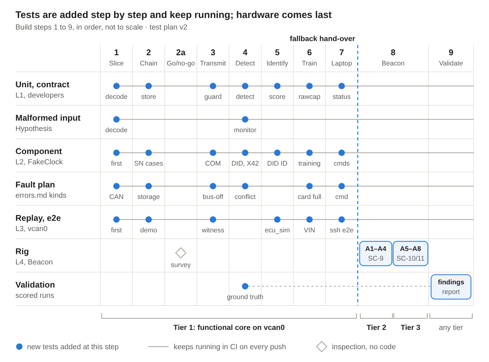

# Test plan walkthrough

A plain-language companion to `docs/test-plan.md` (version 2, Nov 9, 2026). It walks through testing in build order: what each step adds, at which level, and what has to pass before the next step. The plan is the authority; section numbers below point into it. Test names follow the rule that each starts with its requirement ID; the ones shown are examples of the pattern.

## The levels in one paragraph each

Testing uses the four levels in `docs/modules.md` §5, plus validation (plan §2).

1. **Unit (level 1).** One module's public functions, with small in-memory values and `FakeClock`. Developers write these (in `tests/unit/`), together with **contract tests** (mypy checks each module against its `Protocol`, an import test checks only public names are used, import-linter checks the layers) and the **malformed-input** property tests (Hypothesis, SC-12a).
2. **Component (level 2).** `session` runs in-process with `DesktopPlatform(fault_plan)` and `FakeClock`, fed from a fixture folder (`traffic.log` plus `manifest.json`). These live in `tests/component/`, and so does every time-based scenario and every fault test: advancing `FakeClock` turns a 24-hour roll-over into seconds, and the fault plan injects any kind in the `docs/errors.md` Kind column.
3. **Replay and end to end (level 3).** The service runs on `vcan0` (`tests/replay/`, helpers in `tests/harness/`). This level is kept for what needs a real bus or process: the witness that checks everything the logger sends, closed-loop `ecu_sim` devices that answer the logger's requests, laptop commands through `j1939cmd` over `ssh localhost`, and `demo/run_demo.sh`.
4. **Rig (level 4).** Written `bench/` procedures on the Beacon, with Beacon 2 as the independent witness: A1 to A8, the SC-9 load test, the SC-10 soak, the SC-11 scenario suite and the B-procedures.

**Validation** scores the rig runs against ground truth written before each run and produces the findings report.

Levels 1 to 3 run in CI on every push (Python 3.9, DC-1). Level 4 runs on the rig, tier by tier.

## Who writes what

- **Developers (Claude Code sessions):** `src/`, unit tests, contract tests. The unit cases in plan §4 are their checklist.
- **Test-script writers:** fixtures and manifests, `tools/fixtures/scenario.py`, the replay harness, the component runner, component and replay tests, `bench/` procedures and checklists, `tools/findings/` (DC-4).
- Either side changes the other's files only through a DC entry. When a DC entry raises a contract version, the affected tests and fixtures change in the same pull request.

`scenario.py` turns one scenario description into the fixture folder (read by pytest) and the findings ground-truth file (read by the scoring scripts), so the same scenarios serve verification and validation.

## How CI decides coverage

`docs/verification.md` has a Step column (DC-2). CI requires a test for a requirement verified by test only once its build step has merged, so step 1 isn't blocked by step 7's requirements. For the 14 step 8 requirements, a `bench/` procedure ID counts. Before a release tag, every requirement verified by test needs a passing test, a procedure with a result, or a recorded gap. The requirement-to-step map is in plan §10 (95 requirements verified by test, after DC-3).

## Step 1: Thin slice (receive-only)

- **Frozen first:** `types`, `platform`, `capture`, `decode`, `eventlog` (append only), `clock`. The interface code (`types.py`, `platform/interface.py`, `FakeClock`, `DesktopPlatform` with its fault plan) merges before any logic, so test scripts can start the same day.
- **Unit:** `decode` (ID split, NAME decode, transfer reassembly, 1785 bytes accepted and 1786 rejected, non-J1939 frames counted); `capture` (the ring, the stats it reads for LOG-15, and a batch read 1.5 s late doesn't shift `Frame.ts_mono`); `clock` (source choice, `to_utc`, no waiting for the clock); `eventlog` (hash rule, recompute every hash in the session 142 file).
- **Malformed input:** Hypothesis on `decode` starts here, where a reassembly crash is cheapest to find.
- **Fault plan:** `can_missing`, `can_down`, `no_bitrate`, `rx_overflow`.
- **First component and replay test:** a fixture with a new address claim gives a chained `connection_start` within 2 s (`test_DET_1_DET_16_new_claim_logged_within_2s`).
- **Gate:** DET-1, DET-16, LOG-4, LOG-5.

## Step 2: Sessions and hash chain

- **Frozen first:** `session`, `eventlog`, `store`, `verify_chain`, `config`.
- **Unit:** `store` round-trips of every supporting file and `state.json` in a temporary directory; `config` (including inventory and library validation); `verify_chain` (first bad record named, truncated line, unknown format, a replacement card reported as a declared break, not tampering).
- **Component:** buffer size in `session_start` and kernel drops in `session_end` (LOG-15); key-off after 30 s silence; 24 h roll-over; software restart; the session-numbering cases SN-a to SN-f (plan §7: blank card with a state file, missing or corrupt state file, state file behind the card, flash not writable); storage faults (`enospc`, `erofs`, `card_removed` ...) and clock faults.
- **Replay:** `demo/run_demo.sh` runs the session 142 scenario in CI from now on.
- **Gate:** two sessions verify as one chain; a deleted record is named; the demo runs.

### Step 2a: Beacon go/no-go (no code)

A survey of Beacon 1: CAN interfaces, listen-only mode, error reporting, termination, kernel and Python versions, LEDs, RTC across a power cycle, accounts, services, radios, card, CPU, RAM. Version 2 adds two checks: the **boot clock** (after a power cycle with no network, `date` matches `hwclock` before the service starts) and **writable internal flash** for `state.json`. Results decide whether step 8 uses the Beacon or the backup platform.

## Step 3: Transmit (the first time the logger sends)

- **Frozen first:** `transmit`, `address`, `requests`.
- **Unit:** allow-list, 10 frames/s cap, one outstanding request per destination; address choice from 247 down; Cannot Claim after one retry; a Commanded Address to the logger's own NAME is ignored; request timeout and retry.
- **Component:** COM-01, COM-03, COM-04, COM-06, COM-07 (35 minutes of sweeps in seconds), COM-10, COM-11, COM-14, COM-17; fault kinds `bus_off`, `error_passive`, `enobufs`, `tx_breach`, `restart_loop`.
- **Replay:** COM-02, COM-05, COM-08, COM-09, COM-12, COM-13 with `ecu_sim`. From here on, the **witness** checks every replay test: allow-listed PGNs only, within the rate cap, nothing before the bit rate is confirmed.
- **Gate:** NP-1 to NP-19 and LOG-9.

## Step 4: Detection

- **Frozen first:** `detect`, `monitor`.
- **Unit:** connection state machine, address-to-NAME map, move grace, PGN and request tables, control-PGN list.
- **Malformed input:** Hypothesis adds `monitor` (floods of new addresses and PGNs).
- **Component:** detection scenarios DID-01 to DID-13, DID-15 to DID-17, and DID-36 (connection-record fields by category; baseline ECUs get none); name tracking DID-25 to DID-33; attack cases ATK-01 to ATK-06 (for example, an Address Claim Hunter makes the logger concede, send Cannot Claim and go receive-only, with a high conflict for each displaced ECU); benign cases BEN-01 to BEN-04, which must raise no high event.
- **Gate:** all of these pass.

## Step 5: Identification

- **Frozen first:** `identify`.
- **Unit:** category rules; IDN-4 known answers ({A, B, C} against {A, B, D} gives Jaccard 0.5, minus 0.25 for a never-PGN, so 0.25; in session 142 the code reader scores 0.60 and the service tool 0.40 at identification time); tie margin; make and model precedence.
- **Component and replay:** DID-12, DID-13, DID-15; library stress tests DID-18 to DID-24, DID-34, DID-35; `final_identification` (DID-37 when the result changes after later requests, DID-38 when it doesn't). Tests that need identity replies run at level 3 with `ecu_sim`.
- **Analysis:** the DET-13 rule checked against rig captures (X15).

## Step 6: Training and inventory

- **Frozen first:** `inventory`, `rawcap`, `retention`.
- **Unit:** inventory versions and permanent entry IDs; `rawcap` windows contain their record's `utc`; retention order.
- **Component:** training coverage and the 120-minute timeout; approvals and removals; DID-17 (untrained truck); storage nearly full and full.
- **Replay:** DID-14 (VIN mismatch, no VIN reply).

## Step 7: Laptop tool

- **Frozen first:** `cmdserver`, `j1939cmd`, `j1939ctl`, `admin`, `status`.
- **Unit:** the status-light priority table (fast > slow > steady); `cmdserver` protocol checks.
- **Component:** commands over the socket, including the `cmd_*` fault kinds.
- **Replay (end to end over `ssh localhost`):** retrieve (resume, in-progress session, and the **name clash**: same content skipped, different content kept as both and reported); report; approve, remove, clear, train status, config push, restart, retrain; refusals with a reason, the next step and a non-zero exit.
- **Gate:** tier 1 reached, the functional core proven on `vcan0`: the fallback hand-over.

## Step 8: Beacon (system verification)

Beacon 1 runs the release installed offline with `install.sh`; Beacon 2 replays traffic and records as witness.

| Tier | Test | Pass |
| --- | --- | --- |
| 2 | A1 bit-rate detection | Correct rate at 250 and 500 kbit/s on a single network (SC-1, SC-2, PLT-2) |
| 2 | A2 listen-only, then normal | Nothing sent before confirmation |
| 2 | A3 transmit guard, conflict, bus-off; 30 min with and without the logger | Only allowed frames; concedes; bus errors don't rise (SC-4) |
| 2 | A4 60% load with bursts; 100% run | Zero drops at 60%; CPU, memory and drops recorded (SC-9, PLT-7) |
| 3 | A5 power loss and cranking | Clean resume; chain rebuilt |
| 3 | A6 ready time | Recorded in the header |
| 3 | A7 RTC across power loss | Right clock source; no wait for the clock |
| 3 | A8 light states; watchdog | Right pattern; restart with cause |
| 3 | SC-10 24 h soak | No restarts; memory growth under 10% after the first hour; drops within the SC-9 limit; every scripted connection detected |
| 3 | SC-11 scenario suite | Every connection detected and categorized within 2 s; no high events other than the scripted ones in the SC-10 baseline; accuracy reported |

Alongside: B-HW1 (tap stub length), B-HW3 (6 to 32 V), B-PLT2 (CAN controller features), B-STS20 (hardening), B-SN1 (`install.sh` next-session prompt), and the `bench/checklists.md` items for every requirement verified by demonstration, inspection or analysis. An optional truck session after tier 2, if time allows.

On the rig, detection latency (DET-16) is measured from the logger's own times (`connection_start.utc` against `written`), with the sync checked by `strace` and the light by A8, because Beacon 1 and Beacon 2 have different clocks.

## Step 9: Validation and documentation

The `tools/findings/` scripts score the SC-11 runs (and any truck runs) against the ground truth `scenario.py` wrote: detection rate, latency, identification accuracy and confusion table, evidence-source contribution, confidence calibration, leave-one-out accuracy, unknown devices correctly left unidentified, false alarms per hour, and every miss with its cause. The step 9 checklist items (SC-6, IDN-3, IDN-4, STS-8) are signed, and the findings report and test report are written at whatever tier was reached.

## Test methods and how each is judged

| Level | Method | Runs | How it is evaluated |
| --- | --- | --- | --- |
| Unit | pytest on a module's public functions | CI, every push | Exact outputs and known answers; ruff and mypy pass |
| Contract | mypy against the `Protocol`; public-names import test; import-linter | CI, every push | Implementation matches its contract and layer |
| Malformed input | pytest with Hypothesis | CI (fixed seed); nightly (random seed) | No unhandled exception, keeps decoding, within DET-19 limits, counts match |
| Component | `session` in-process, fixture folder, `FakeClock` | CI, every push | Manifest matching (type, severity, listed fields, `within_s`, `count: 0`, `expect_no_other`); `verify_chain` over every session file |
| Fault plan | `DesktopPlatform` fault plan with `docs/errors.md` kinds | CI, every push | The row's action, record, light and transmit state all match |
| Replay, end to end | Service on `vcan0`, witness, `ecu_sim`, `j1939cmd` | CI, every push | Manifest matching; witness sees only allowed frames within the cap; commands log the right records and refuse correctly |
| Rig | Written `bench/` procedures and checklists | A person on the rig, per tier | Each procedure's pass criterion; result, date, platform and evidence in `docs/verification.md` |
| Validation | Scoring scripts over logged runs | After the rig runs | Not pass/fail: measured performance, every number produced by script |
